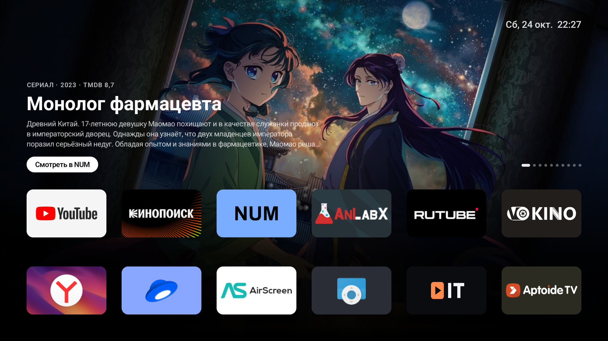

# tvhome

Минималистичный лаунчер для Android TV в стиле Apple TV и заставка с видео Apple Aerial.
Проверялся на Ugoos SK1 (Android 14, 4K), должен работать на любой Android TV / Google TV приставке с Android 12+.



## Что внутри

**Главный экран**
- Верхняя полка как Top Shelf на tvOS: 20 новинок недели из TMDB на русском (обновляются раз в 3 часа), кадр на весь экран, название, год, рейтинг, описание. Листаются сами каждые 9 секунд. Вверх с ряда приложений - фокус на полке, стрелки листают, OK открывает фильм в [NUM](https://github.com/YouROK/NUM).
- Плитки приложений 5:3 с баннерами Android TV. Плитка в фокусе увеличивается, получает тень и блик, под ней появляется подпись.
- Фон - размытый баннер приложения в фокусе, меняется с плавным переходом.
- Первый ряд - док, ниже остальные приложения. Новые приложения появляются сами.
- Часы в углу.

**Перестановка приложений**
- Удержать OK или нажать Menu на плитке - плитка начинает дрожать.
- Стрелки двигают её, OK или Back - готово. Порядок сохраняется.

**Заставка "Аэросъёмка"**
- 114 видео Apple Aerial в 4K HEVC (SDR), случайный порядок, без звука.
- Часы и дата сверху справа, в начале каждого ролика на несколько секунд появляется название места на русском.
- Видео стримится с `sylvan.apple.com`. Сервер подписан Apple Root CA, которого нет в хранилище Android, поэтому корневой сертификат лежит в `res/raw` и подключён только для этого домена (`network_security_config.xml`).

## Установка

Нужен `adb` и включённая отладка на приставке (Настройки -> Для разработчиков -> Отладка по сети/USB).

```sh
adb connect <ip-приставки>:5555
adb install -r tvhome.apk

# главный экран по умолчанию
adb shell cmd package set-home-activity --user 0 home.tv.launcher/.MainActivity

# заставка и задержка 10 минут
adb shell settings put secure screensaver_components home.tv.launcher/.AerialDream
adb shell settings put secure screensaver_enabled 1
adb shell settings put system screen_off_timeout 600000
```

APK лежит в [Releases](../../releases).

Для полки новинок нужен бесплатный ключ TMDB (themoviedb.org -> Settings -> API, подходит и "Ключ API", и "Read Access Token"). Ключ хранится только на приставке:

```sh
adb shell am start -n home.tv.launcher/.MainActivity --es tmdb_key <ключ>
```

Без ключа вместо полки фон из размытого баннера приложения в фокусе.

Вернуть стоковый лаунчер (пакет посмотреть так: `adb shell cmd package query-activities --brief -a android.intent.action.MAIN -c android.intent.category.HOME`):

```sh
adb shell cmd package set-home-activity --user 0 <пакет>/<активити>
```

## Сборка

JDK 17+ (подойдёт JBR из Android Studio), Android SDK с platform 37.

```sh
export JAVA_HOME="/Applications/Android Studio.app/Contents/jbr/Contents/Home"
./gradlew assembleRelease
# app/build/outputs/apk/release/app-release.apk
```

Release подписывается debug-ключом, этого хватает для установки через adb.

Список роликов `app/src/main/assets/aerials.json` собирается из манифеста Apple:

```sh
curl -O https://sylvan.apple.com/Aerials/resources-16.tar
tar -xf resources-16.tar entries.json TVIdleScreenStrings.bundle/ru.lproj
plutil -convert json -o ru.json TVIdleScreenStrings.bundle/ru.lproj/Localizable.nocache.strings
python3 tools/build_aerials.py entries.json ru.json > app/src/main/assets/aerials.json
```

## Нюансы

- TMDB отдаёт российским DNS-резолверам 127.0.0.1. Лаунчер резолвит домены TMDB через DNS-over-HTTPS Cloudflare (`Shelf.kt`). Части IP картинок (Bunny CDN) напрямую из РФ может не быть, тогда нужен туннель на роутере.

- Стоковые лаунчеры Ugoos (`com.uapplication.launcher`, `com.android.launcher3`) скрыты из списка, см. `HIDDEN` в `Apps.kt`. Для других приставок дописать свои.
- `adb exec-out screencap` на Amlogic не снимает видеослой, заставка на скриншоте выглядит чёрной.
- Видео Apple Aerial принадлежат Apple, в репозитории только ссылки на них.
